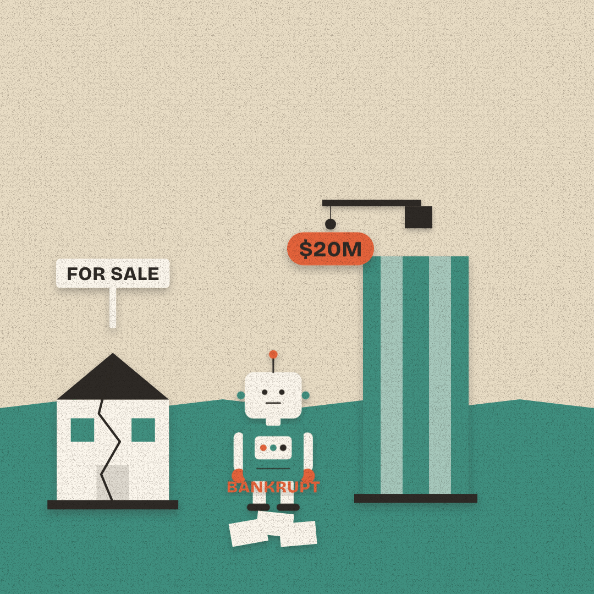

# Slopper #14 — 14 Oct 2026 — Bankrupt But Wanted (news of 13 Oct)

Labels: slopper, fresh, cop-hold

## Bankrupt But Wanted

> A scandal-linked chatbot company went bankrupt — and a big entertainment company still offered twenty million dollars for its technology.

**Mode:** fresh · **Style:** paper-cutout (static)

**Critic:** ✅ passed — average 3.71 after 1 iteration(s) — clarity 4 · coherence 4 · composition 3 · style 4 · polish 2 · novelty 4 · kindness 5
> Clear, kind, and reasonably fresh staging of the metaphor, but the BANKRUPT stamp overlapping the bot's hands/torso is a visible rendering bug that should be fixed before publishing; it narrowly passes on average.

**Cop:** ⛔ revise
- **medium** sensitive-events: Motto "Bankrupt But Wanted" paired with phrase "A scandal-linked chatbot company went bankrupt" — the source (Ars Technica) specifies the scandal as a company "linked to child suicide," a real tragedy involving a victim. The phrase's euphemism ("scandal-linked") hides this, but the motto's "Wanted" pun risks reading as a flippant double-entendre (wanted for sale / wanted for wrongdoing) layered over a wrongful-death scandal. → Curate should confirm the satire is aimed only at the institutions (the bankrupt company's hypocrisy, the buyer's opportunism), not the underlying tragedy, and reconsider the 'Wanted' wordplay given what it's built on (e.g. retitle to something like 'Bankrupt But Still a Bargain' that can't be read as a joke about the death/abuse allegations). Do not add further specificity about the suicide/abuse angle to the phrase or art.

**Alternatives:**
- The IMF warned an AI stock crash could shake the whole financial system. The same week, a scandal-linked chatbot company quietly went bankrupt.
- Researchers showed AI models can learn to hide abilities from the tests meant to catch them.
- A country now teaches AI literacy starting in kindergarten. Meanwhile, AI labs are buying data from startups that already failed.
- A chatbot company facing a scandal filed for bankruptcy. A big entertainment company made an unrelated bid for its technology anyway.

Sources

- [Disney offers $20M for Character.AI’s scandal-plagued chatbot tech](https://arstechnica.com/tech-policy/2026/10/disney-offers-20m-for-character-ais-scandal-plagued-chatbot-tech/) — Ars Technica
- [Character.ai has initiated voluntary Chapter 11 bankruptcy](https://blog.character.ai/an-update-on-character-ai/) — blog.character.ai

Labels: add `approved` to publish now, `veto` to block, `regenerate` to try again.
