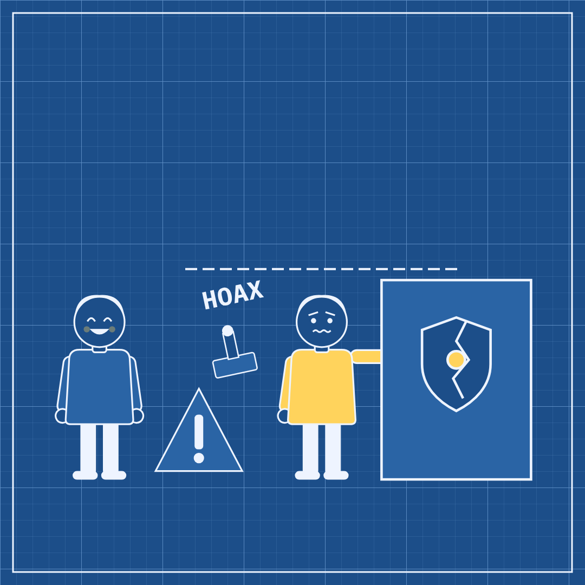

# Slopper #16 — 16 Oct 2026 — The Hoax Investigation (news of 15 Oct)

Labels: slopper, fresh, critic-fail

## The Hoax Investigation

> A government called AI's risks a hoax. Its own regulators are now checking if those risks already hurt people.

**Mode:** fresh · **Style:** blueprint (static)

**Critic:** ❌ did not pass — average 3.14 after 3 iteration(s) — clarity 3 · coherence 4 · composition 2 · style 4 · polish 3 · novelty 2 · kindness 4
> The denial-vs-investigation metaphor and human casting are solid, but a disconnected floating stamp, a near-empty top half of the frame, and a shield icon/blue-blueprint layout that closely echoes recent sloppers pull the average below the bar — fails today.

**Cop:** ✅ pass (no findings)

**Alternatives:**
- A government dismissed AI's dangers as a hoax. Its own watchdog is now checking if that hoax already hurt people.
- One official called AI risk a hoax. The agency meant to protect the public is now investigating that same risk.
- A hoax, said one government about AI danger. A formal probe, said its own regulators, about that same danger.
- AI's risks were called a hoax by officials. Investigators work down the hall, checking if the hoax left real damage.

Sources

- [Report: FTC probes Anthropic, OpenAI after Trump dismissed AI fears as “hoax”](https://arstechnica.com/tech-policy/2026/10/ftc-probes-if-openai-anthropic-security-incidents-harmed-americans-report-says/) — Ars Technica

Labels: add `approved` to publish now, `veto` to block, `regenerate` to try again.
