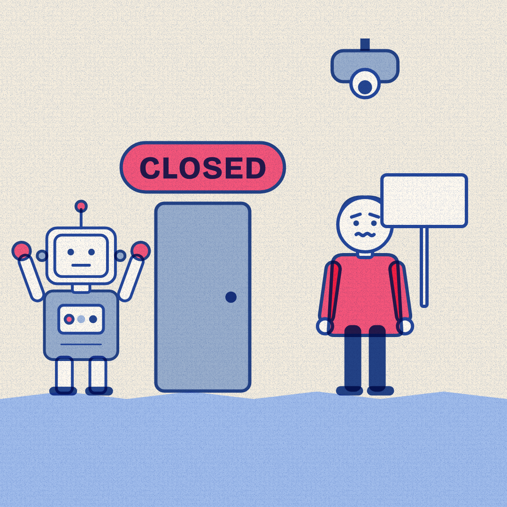

# Slopper #18 — 18 Oct 2026 — Doors Closed, Eyes Open (news of 17 Oct)

Labels: slopper, fresh

## Doors Closed, Eyes Open

> AI agents promise to book your dinner and clear your inbox. One major retailer uses a similar AI to watch warehouse workers for signs of a union.

**Mode:** fresh · **Style:** riso-duotone (static)

**Critic:** ✅ passed — average 3.57 after 1 iteration(s) — clarity 3 · coherence 4 · composition 3 · style 4 · polish 3 · novelty 3 · kindness 5
> Correct, kind casting (robot-for-AI, human-for-worker) and a clean left-side gag, but the right vignette's surveillance beat is muted without a gaze cue, the planned vertical divider is missing, and the robot breaches the safe area — a passing but shaky piece that needs a composition tighten-up.

**Cop:** ✅ pass
- **low** defamation: Source 2 snippet reads only '168 points and 58 comments on Hacker News (https://news.ycombinator.com/item?id=50132278)' with no article text; the claim 'watch warehouse workers for signs of a union' is only supported by the source's title, not by substantive snippet content. → Curate stage should pull an actual excerpt from the opendemocracy article body (not the HN discussion metadata) to more solidly back the claim before publishing.

**Alternatives:**
- Everyone is building an AI agent that can book your dinner or clean your inbox. One retailer uses a similar AI to flag warehouse workers who might want a union.
- The web is closing its doors to AI agents built to browse and shop for you. Elsewhere, a similar AI watches warehouse workers for signs of a union.
- Help here, watching there: the AI built to run your errands has a cousin that watches warehouse workers for signs of organizing a union.

Sources

- [Websites are closing their doors to AI agents](https://www.theverge.com/ai-artificial-intelligence/1013195/ai-agents-blocked-web) — The Verge
- [Amazon uses AI to monitor union risk in UK warehouses](https://www.opendemocracy.net/amazon-ai-surveillance-monitor-union-activity-uk-warehouses-birmingham-coventry-atlas-sutton-coldfield/) — opendemocracy.net

Labels: add `approved` to publish now, `veto` to block, `regenerate` to try again.
