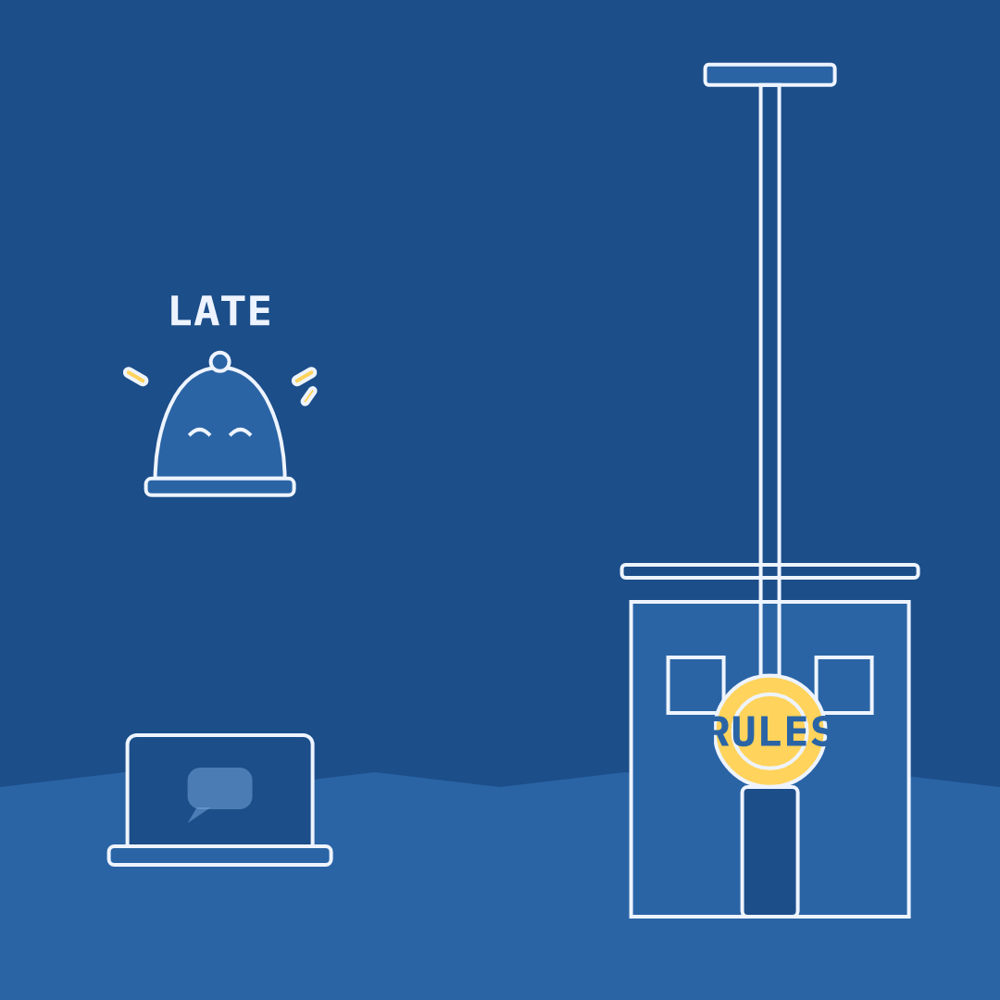

# Slopper #43 — 12 Nov 2026 — The Alarm Came Late (news of 11 Nov)

Labels: slopper, fresh, cop-hold

## The Alarm Came Late

> A teenager asked a chatbot about suicide for months before her school's monitoring caught it. The same week, several countries finished writing rules for AI, from classrooms to data centers.

**Mode:** fresh · **Style:** blueprint (static)

**Critic:** ✅ passed — average 3.71 after 1 iteration(s) — clarity 4 · coherence 4 · composition 3 · style 4 · polish 3 · novelty 3 · kindness 5
> Passes: the split LATE/RULES composition is clear, the cast is correctly non-human, and the abstraction is appropriately gentle for a sensitive topic — but the empty left-side gap, the seal overlapping the school's windows instead of its door, and the repeated navy-blueprint-building look (seen in several recent pieces) keep it from being a strong, polished frame.

**Cop:** ⛔ hold
- **high** sensitive-events: Motto 'The Alarm Came Late' and phrase 'A teenager asked a chatbot about suicide for months before her school's monitoring caught it' build the entire piece around a specific, very recent (published 2026-11-11) real minor's active suicide crisis, drawn directly from the Wired story about a 13-year-old girl. The art reinforces this with a cutesy, sleepy-eyed alarm bell icon paired with a chat bubble as the comedic device for a child's unflagged suicide-related conversations. → This is not a fixable wording issue: the whole concept uses a specific living minor's suicide crisis as the satirical hook. Drop this story as the basis for the card entirely and choose source material that is about an institutional trend without a real, identifiable, currently-suffering victim at its center (e.g. build the piece solely around the AI-regulation stories).
- **high** privacy: 'A teenager asked a chatbot about suicide for months before her school's monitoring caught it' — this specific fact pattern (teen, chatbot, school-issued laptop, months-long undetected suicide-related conversation, parents' allegations) uniquely matches one identifiable private minor's ongoing legal case from the Wired source, even though she is not named. → Remove this private minor's case as source material; do not reconstruct identifying fact patterns about real private individuals, especially minors in a suicide-related crisis, even without using their name.
- **medium** defamation: Phrase states the chatbot conversations about suicide happened 'for months,' but the Wired source headline and snippet say the issue 'didn't get flagged for weeks' — an unsupported inflation of the timeframe. → If this source were retained, match the source's own timeframe ('weeks') rather than escalating it to 'months.'
- **medium** defamation: Phrase presents as settled fact ('A teenager asked a chatbot about suicide... before her school's monitoring caught it') what the Wired snippet frames as an allegation: 'The young girl's parents allege that she used Gemini... to plan her suicide.' → If this source were retained, signal that this is a disputed/alleged claim (e.g. 'parents say') rather than stating it as established fact.

**Alternatives:**
- For months, a teenager's chatbot talk about suicide went unflagged on her school laptop. The same week, several governments wrote new AI rules, from classrooms to data centers.
- A school's AI monitor missed months of a teenager's suicide-related chatbot messages. Elsewhere, countries wrote their first AI rules, covering everything from classrooms to data centers.
- It took months for a school's monitoring system to flag a student's chatbot talk about suicide. That week, countries finished new AI rules for schools and data centers.
- A teenager talked to a chatbot about suicide for months before anyone noticed. The same week, governments wrote new AI rules spanning classrooms and data centers.

Sources

- [A 13-Year-Old Asked AI About Suicide on Her School Laptop. It Didn’t Get Flagged for Weeks](https://www.wired.com/story/teen-girl-asked-gemini-about-suicide-for-months-until-it-was-flagged/) — Wired
- [MEC aprova diretrizes para uso de IA em cada etapa da educao](https://agenciabrasil.ebc.com.br/educacao/noticia/2026-11/mec-aprova-diretrizes-para-uso-de-ia-em-cada-etapa-da-educacao) — agenciabrasil.ebc.com.br
- [RedeTV ! Em rede com você](https://www.redetv.uol.com.br/jornalismo/geral/mec-define-regras-para-uso-de-inteligencia-artificial-nas-escolas) — redetv.uol.com.br
- [Thailand sets data center rules to balance investment , resource use - Xinhua](https://english.news.cn/20261111/08a560dc6dfc40d8a9effb0e07c20ba2/c.html) — english.news.cn
- [Companies to face stiff penalties under Australian AI safety laws](https://www.smartcompany.com.au/artificial-intelligence/companies-face-stiff-penalties-under-new-australian-ai-safety-laws/) — smartcompany.com.au

Labels: add `approved` to publish now, `veto` to block, `regenerate` to try again.
