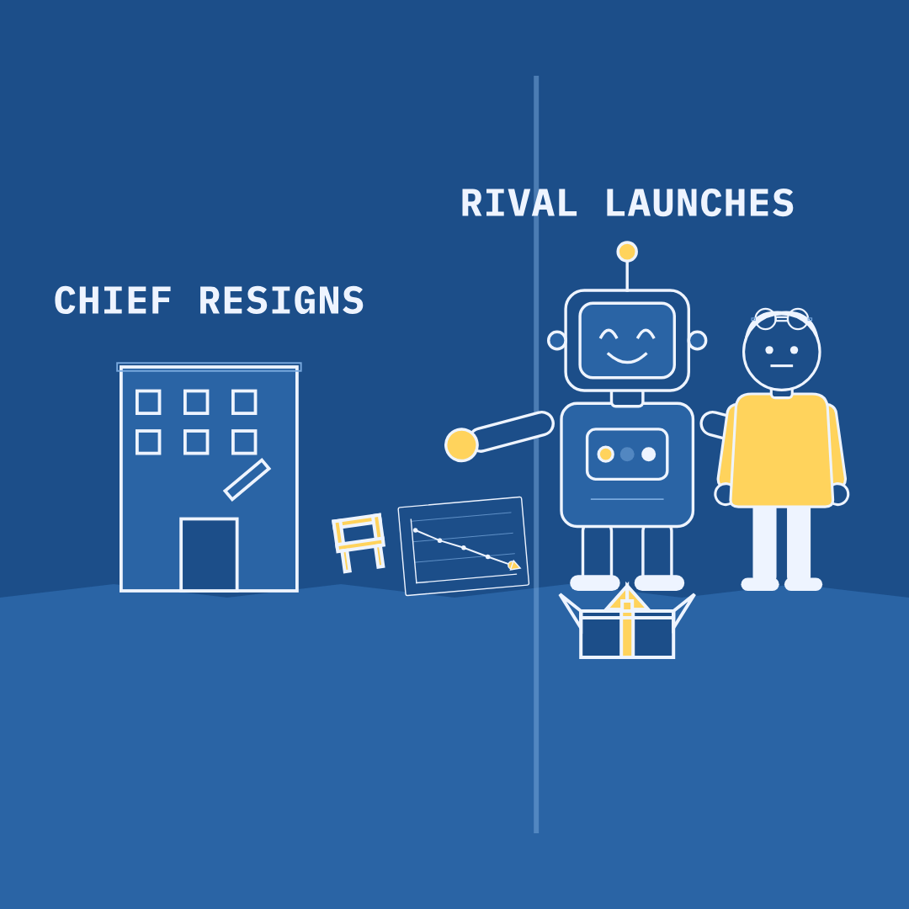

# Slopper #44 — 13 Nov 2026 — Chief Resigns, Rollout Continues (news of 12 Nov)

Labels: slopper, fresh

## Chief Resigns, Rollout Continues

> A chip maker's leadership shake-up rattled investors today. The same day, a search giant launched a smarter model, a sharper search tool, and new glasses.

**Mode:** fresh · **Style:** blueprint (static)

**Critic:** ✅ passed — average 3.71 after 2 iteration(s) — clarity 4 · coherence 4 · composition 4 · style 4 · polish 3 · novelty 2 · kindness 5
> A clean, readable blueprint split-frame that gets the two-track joke across, but it narrowly passes: the robot's glasses hand-off doesn't visually connect (empty gesturing hand, glasses already on the human), and the whole split/divider/falling-chart/robot-with-box composition closely echoes the most recent slopper.

**Cop:** ✅ pass (no findings)

**Alternatives:**
- A chip maker lost its chief executive amid scandal, and investors took notice. Elsewhere, a search giant rolled out a smarter model and stylish new glasses.
- One company's chief executive resigned in scandal today, rattling its investors. Another company spent the day showing off a smarter model and new glasses.
- A chip maker's boardroom scandal cost it a chief executive today. A rival calmly launched a smarter model, sharper search, and new glasses.

Sources

- [Jensen Huang resigns](https://apnews.com/article/nvidia-megaspeed-china-singapore-huang-5403f152a601cf82ce939f1d24fffa0f) — apnews.com
- [Jensen Huang Basically Lit More Than $1 Trillion on Fire in Less Than a Month](https://www.wired.com/story/jensen-huang-tanked-a-trillion-dollars-in-less-than-a-month/) — Wired
- [The Jensen Huang scandal is hardly over](https://www.theverge.com/ai-artificial-intelligence/1032069/jensen-huang-resignation-affair-chips-smuggling) — The Verge
- [Google rolls out Gemini 4 Hydrogen, finally replacing 3.8 Flash](https://arstechnica.com/google/2026/11/google-rolls-out-gemini-4-hydrogen-finally-replacing-3-8-flash/) — Ars Technica
- [Google’s new Gemini model is better at understanding complicated questions](https://www.theverge.com/ai-artificial-intelligence/1032505/google-search-ai-mode-gemini-4-hydrogen) — The Verge
- [Google pushes privacy angle as Gemini-powered smartglasses debut starting at $395](https://arstechnica.com/google/2026/11/google-pushes-privacy-angle-as-gemini-powered-smartglasses-debut-starting-at-395/) — Ars Technica

Labels: add `approved` to publish now, `veto` to block, `regenerate` to try again.
